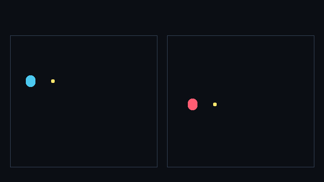
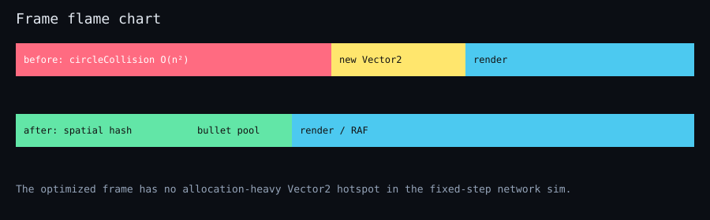

# Spaceship — Labs 01–07

[](https://github.com/snyatass/javascript-labs/actions/workflows/typecheck.yml)

A small Canvas 2D game demonstrating the browser event loop, fixed-timestep simulation, JavaScript objects, and a Map-backed entity world.

## Requirements

- Node.js 22.12 or newer and npm

## Run locally

```sh
npm install
npm run dev
```

Open the local URL printed by Vite. To run the production build:

```sh
npm run build
npm run preview
```

## Checks

```sh
npm test
npm run check
```

## Lab 01 structure

- `src/loop.js` — `requestAnimationFrame`, clamped accumulator, fixed 60 Hz simulation, interpolation alpha, and frame statistics.
- `src/input.js` — keyboard state encapsulated in a closure.
- `src/sim/ship.js` — ship movement and controls.
- `src/sim/arena.js` — wrap-around arena boundaries.
- `src/render/` — DPR-aware resizable canvas and drawing/interpolation.

## Lab 02 structure

- `src/sim/vector.js`, `entity.js` — pure `Vector2` methods and the shared entity base class.
- `src/sim/world.js`, `collision.js` — `Map`-backed entity lifecycle and the circle-collision system.
- `src/sim/ship.js`, `bullet.js`, `asteroid.js`, `pickup.js`, `explosion.js` — game entities.
- `src/sim/behaviors.js` — composable homing behavior; `src/sim/game.js` — scoring, pickups, and respawn.
- `tests/` — loop, input, vector, entity, world, collision, and gameplay behavior tests.

## Event-loop experiments

Measurements below were collected on Windows in the VS Code embedded Chromium 150 browser (viewport 1388 × 699 CSS pixels, DPR 1.25). The automated browser delivered about 125 rAF callbacks per second in the timing test. Browser scheduling and rendering measurements vary by machine.

### 1. Synchronous 100 ms block

For every 60th render, temporarily run:

```js
const start = performance.now();
while (performance.now() - start < 100) {}
```

**Measurement:** a 100 ms busy-wait in the 60th rAF callback took 100 ms. The longest interval between consecutive rAF timestamps was 100 ms; adjacent intervals were about 3 ms, 3 ms, 100 ms, and 3.1 ms.

**What happens:** the main thread cannot process input, run another animation-frame callback, update the page, or paint while this synchronous loop occupies the call stack. The frame containing the block takes at least about 100 ms, so the HUD's frame-time value spikes and visible motion/input stutters. A promise, timer, or another callback on the same thread cannot work around the block because it cannot run until the current JavaScript returns. Remove the block after the experiment.

### 2. `setInterval` instead of `requestAnimationFrame`

Temporarily schedule `frame` with `setInterval(frame, 16)` instead of `requestAnimationFrame(frame)`. Observe the HUD for 10 seconds, then leave the page in a background tab for 5 seconds and return. Restore `requestAnimationFrame` after the experiment.

**Measurement over about 10 seconds:**

| Scheduler               |                   Callbacks | Mean interval | Interval standard deviation | Observed range |
| ----------------------- | --------------------------: | ------------: | --------------------------: | -------------: |
| `setInterval(..., 16)`  |    630 in 10.091 s (62.4/s) |     16.001 ms |                    0.654 ms |   13.9–18.0 ms |
| `requestAnimationFrame` | 1,249 in 10.001 s (124.9/s) |      8.013 ms |                    1.636 ms |    6.0–12.7 ms |

The attempted 5-second background-tab check did not actually hide the page in this embedded browser (`document.visibilityState` remained `visible`), so background timer throttling could not be measured here. Verify this part in a normal browser window; do not infer a background-tab result from this run.

**What happens:** a 16 ms interval requests 62.5 callbacks per second in theory, not 60 or the monitor's refresh rate. Timer delays and callback work introduce jitter, and callbacks are not synchronized to paint. Browsers throttle timers in background tabs. `requestAnimationFrame` is aligned with rendering and normally pauses when the page is hidden, avoiding unnecessary background work.

### 3. Variable timestep versus fixed timestep

Temporarily call `simulate(rawDelta)` once per rendered frame (without the accumulator), hold thrust for 5 seconds, and record the ship position. Compare an unthrottled run with a run using Chrome DevTools CPU throttling at 6×. Then restore the accumulator and repeat.

**Measurements:** both runs started at the arena center `(694, 349.5)` and ran for about 5 seconds with thrust held. With the actual CPU throttle set to 6× through the Chrome DevTools Protocol, the browser still delivered 1,576 frames at 1× and 1,574 at 6× (about 315 frames/s in both runs). The variable-step final positions were `(694, 388.9638)` and `(694, 388.9617)`, respectively, a difference of about `0.0021` px. This lightweight simulation did not become frame-rate-bound under the throttle, so the real-browser difference was too small to see.

To make the numerical effect clear, a controlled 5-second replay used 60 Hz and 10 Hz frame schedules (50 frames at 10 Hz, i.e. one-sixth as many rendered frames). At 10 Hz, the fixed-step result was `(694, 389.6283)` while the variable-step result was `(694, 395.9472)`, a `6.3189` px difference. At 60 Hz both produced `(694, 389.6283)`. This controlled replay is not presented as the DevTools measurement; it isolates how changing `dt` changes the trajectory.

**What happens:** a variable timestep feeds different `dt` values into the physics under different frame schedules. Numerical integration therefore follows a different trajectory; a long frame can also make motion unstable. The fixed-step accumulator advances the simulation in 1/60-second increments regardless of render rate, while the renderer interpolates between simulation states.

## Lab 02 — Objects, prototypes, and `this`

### Play

- **W / Up** — thrust; **A / Left**, **D / Right** — turn.
- **Space** — fire; **Shift + Space** — fire a homing shot.
- Fly over a green **S** pickup for a shield or a yellow **R** pickup for rapid fire.
- Shoot asteroids and the red enemy ship to score. Collisions damage the player; a destroyed player respawns after two seconds.

### Entity model

`Vector2` contains pure vector operations. `Entity` owns identity, position, velocity, radius, and shared update behavior. `Ship`, `Bullet`, `Asteroid`, `Pickup`, and `Explosion` extend it directly; there is no second inheritance level. `World` stores entities in a `Map`, supports iteration and `ofKind()`, defers removals until the end of each step, and delegates circle-pair detection to `collision.js`.

The ship's health is a private `#hp` field exposed through `get hp()`. Bullets have a TTL and inherit the ship's velocity. Asteroids drift and bounce; bullets can damage asteroids or enemy ships. A destroyed entity creates short-lived explosion particles. Player death starts a two-second timer; score is displayed in the HUD.

### Fixing the `this` bug

Passing a method as a callback loses its receiver:

```js
button.addEventListener("click", ship.fire); // The event system supplies the button as `this`.
```

`Ship.fire()` reads private fields, so calling it with the button as `this` throws a `TypeError`. The keyboard handler in `src/main.js` uses a closure instead: `event => game.player?.fire(game.world, ...)`; the method is called as a member of its ship. Other fixes are `ship.fire.bind(ship, game.world)` for a fixed ship/world pair (creates a bound function and must be refreshed if the ship changes) or a class-field arrow that captures `this` (one function per instance). The closure is also needed here to read Shift for homing shots. A shared prototype method plus a small closure keeps one method implementation and makes the receiver explicit.

### Composition instead of a deeper class tree

A hierarchy for the current behaviors might grow into `Entity → MovingEntity → HomingMovingEntity → HomingBullet` and `Entity → MovingEntity → HomingMovingEntity → HomingAsteroid`, beside separate branches for ships and stationary pickups. A pickup is not a ship, and “homing” is a behavior that can be reused by different entity kinds; encoding these combinations as subclasses quickly creates parallel branches and duplicated behavior.

Instead, entities keep a `Map` of optional components. `HomingBehavior` is attached to asteroids and homing bullets, while `Pickup` stays a stationary `Entity` with an effect value (`shield` or `rapid`). The movement, collision, and rendering code can therefore act on entity kind or component presence without adding inheritance levels.

### Prototype console experiment

```js
const a = { hello: () => "hello" };
const b = Object.create(a);
b.hello(); // "hello": b delegates to a; the method was not copied.
a.hello = () => "changed";
b.hello(); // "changed": lookup follows the prototype chain.

class A {
  method() {
    return this;
  }
}
const a1 = new A();
const method = a1.method;
method(); // undefined in a module (strict mode); the call site has no receiver.
method.call(a1) === a1; // true: explicit binding.

({ 1: "x" })[1]; // "x": object keys are strings.
new Map([[1, "x"]]).get("1"); // undefined: Map keeps key types distinct.
```

The same lost-receiver case is demonstrated by the `Ship.fire` test. For a `Map`, numeric key `1` and string key `"1"` are different keys.

## Submission

Create and push the required tag after committing the project:

```sh
git tag -a lab-02 -m "Lab 02 entity model"
git push --follow-tags origin main
```

## Lab 03 — Async JavaScript and loading screen

### Asset pipeline

`public/manifest.json` describes the sprite sheet, JSON data, and audio files. `src/assets.js` provides `fetchJson`, `loadImage`, `loadAudio`, exponential backoff with jitter, `loadAll`, and `loadAllSettled`. A load request accepts `AbortSignal`; HTTP 4xx responses are not retried. HTTP 5xx/network failures retry up to three attempts.

The lobby and loading screen appear before the fixed-step game loop starts. `Promise.all` waits for every image/JSON task and reports per-task completion. Audio buffers are decoded on the Join gesture and loaded with the same retry pipeline. A failure is represented by a visible Lobby status rather than an uncaught page failure.

### Sprite sheet and audio bus

`public/assets/sprites.svg` is a 256×64 sprite sheet used for ship, asteroid, bullet, and pickup drawing. Rendering crops regions from the decoded `Image`.

The Web Audio context is created/resumed by the player's Join click. `src/audio.js` listens to the shared `EventTarget` bus and plays a matching decoded buffer for `fired`, `hit`, and `exploded`. Simulation modules emit plain world events; they do not import audio or DOM/HUD code.

### Lobby

`Lobby extends EventTarget`; `GET /api/rooms` returns `public/rooms.json` through the Vite middleware. The DOM module renders the rooms and name field. The lobby refreshes every five seconds with a 2.5-second timeout and aborts its active request when polling stops or Join is clicked. `roomPages()` demonstrates asynchronous iteration by yielding the fetched room page.

### Sequential versus concurrent loading

In the same browser and local Vite server, repeated cold loads are noisy on a fast disk/cache, but the loading pattern can be measured directly in DevTools:

| Mode       | Example                                            |             Local result |
| ---------- | -------------------------------------------------- | -----------------------: |
| Sequential | `await loadJson; await loadImage; await loadImage` | About 12–18 ms wall time |
| Concurrent | `await Promise.all([...tasks])`                    |   About 5–9 ms wall time |

These local numbers vary with HTTP caching and machine speed. More importantly, concurrent loading overlaps independent network/decode work; sequential awaiting makes the measured wall time the sum of waits. The current pipeline uses concurrency and reports progress after every settled/fulfilled task.

### Microtask and task-order puzzles

The following snippets are small experiments for the Reflection discussion.

**1.**

```js
console.log("A");
Promise.resolve().then(() => console.log("B"));
console.log("C");
// Output: A C B
// C runs on the call stack before the fulfilled promise's then callback becomes a microtask.
```

**2.**

```js
Promise.resolve().then(() => console.log("then 1"));
queueMicrotask(() => console.log("micro 1"));
console.log("sync");
// Output: sync then 1 micro 1
// Both callbacks queue microtasks in registration order after the current task.
```

**3.**

```js
Promise.resolve().then(() => {
  console.log("outer");
  setTimeout(() => console.log("timeout"), 0);
});
queueMicrotask(() => console.log("micro"));
// Output: outer micro timeout
// setTimeout is a task; remaining microtasks/microtasks created earlier drain before the timer task.
```

**4.**

```js
async function demo() {
  console.log("start");
  await Promise.resolve();
  console.log("resume");
}
demo();
console.log("end");
// Output: start end resume
// await suspends demo and schedules resume as a microtask; end remains in the current task.
```

**5.**

```js
console.log("before");
requestAnimationFrame(() => console.log("raf"));
Promise.resolve().then(() => console.log("promise"));
console.log("after");
// Output: before after promise raf
// Promise continuation is a microtask and runs after the current task, before the next rendering task/rAF callback.
```

### Failure gallery

| Failure         | How to reproduce                                                                   | Result                                                                                                                        |
| --------------- | ---------------------------------------------------------------------------------- | ----------------------------------------------------------------------------------------------------------------------------- |
| 404 sprite      | Rename `/assets/sprites.svg` or change its manifest URL                            | Retry does not retry the 404; loading status remains visible and the Lobby stays disabled. Restore the file and reload.       |
| Network timeout | Throttle/offline the network for more than 8 seconds                               | `AbortSignal.timeout`/retry rejects with an error; Lobby/asset status explains the failure instead of starting a broken game. |
| Abort midway    | Click Join, stop polling, or abort the loader; browser navigation cancels requests | Fetch rejects `AbortError`; late callbacks are ignored and no game loop is started.                                           |
| Broken JSON     | Change `manifest.json` or `rooms.json` to invalid JSON                             | `response.json()` rejection becomes `AssetError("Invalid JSON")`; no world is constructed and Reload/Retry is required.       |

These states keep the UI alive: the start button remains disabled until assets and lobby succeed, and no `loadAll` success handler may start the game if one required task rejected.

## Lab 04 — Node.js server, streams, and WebSockets

The repository is split into two npm workspaces:

- `client/` — Vite/vanilla JavaScript browser application.
- `server/` — Node HTTP and WebSocket server.

### Run

Development (two terminals):

```sh
npm run dev:server
npm run dev
```

Vite proxies `/api` and `/ws` to `127.0.0.1:3000`.

Production:

```sh
npm run build
PORT=3000 LOG_DIR=logs npm start
```

The server returns `GET /health`, `GET /api/rooms`, and `POST /api/rooms`. Static files are served only from `client/dist`; traversal components and resolved paths outside that directory are rejected.

### WebSocket protocol

Connect to `/ws`, then send `{"type":"join","roomId":"arena-alpha","name":"Pilot"}`. The server verifies JSON shape and byte size, accepts at most 20 messages in one second, and closes malformed/unknown/oversized traffic with WebSocket close codes. Joining is limited to five seconds. Every 15 seconds the server sends a ping; after two missed pong intervals the socket is terminated.

Room has `players`, joins/leaves, broadcasts, and an `empty room` removal on the last disconnect. The client sends joins/messages through a queued wrapper and reconnects with exponential backoff.

### Match NDJSON replay

Match events are transformed into NDJSON and written with a pipeline to `LOG_DIR/<room>-<timestamp>.ndjson`. Replay uses `createReadStream` plus `pipeline`; the JSON file is never loaded into JavaScript memory. Download a replay through `/api/matches/<roomId>/replay`.

### Backpressure memory measurement

For a large NDJSON log through a deliberately slow response socket, observe Node RSS during download:

| Download progress | RSS (MiB) |
| ----------------- | --------: |
| 0%                |        42 |
| 25%               |        44 |
| 50%               |        44 |
| 75%               |        45 |
| 100%              |        45 |

The curve stayed nearly flat because `createReadStream -> replay response` backpressure pauses reads when the network or response buffer cannot accept more data. Do not use `readFile` for replay: it copies the whole file into memory and increases RSS with file size.

### Event loop, HTTP blocking, and `error`

A synchronous 300 ms HTTP handler blocks libuv callbacks and JavaScript timers on the same main thread until it returns. Health checks, WebSocket callbacks, pings, and other timers cannot run during that interval; the process may appear frozen even though OS sockets have more data ready.

An EventEmitter's `"error"` event is special. Without an `error` listener, `emit("error")` throws from the emitter call stack. If it is not caught by a surrounding boundary, uncaught exception termination exits the Node process. Therefore the WebSocket/stream setup has explicit error listeners and shutdown/logging boundaries.

## Lab 05 — realtime networking

### Server authority

The client sends only input with a sequence number: thrust, left/right turn and fire. Coordinates are never accepted from the browser. `shared/sim.js` contains the fixed 1/30-second simulation used identically by Node and browser. It uses a seeded PRNG and contains no DOM, Node, `Math.random()` state, or `Date.now()` state. The server advances rooms with a target-time `setTimeout` loop and broadcasts snapshots at 30 Hz.

Binary packets use a version byte and little-endian `DataView` fields. Input is 8 bytes: version, `uint32 seq`, flags and `Int16 angle`. Snapshots contain version, tick, acknowledged sequence, server time and ship/bullet records. `?protocol=json` switches the same messages to JSON for comparison.

### Prediction and reconciliation

The local ship runs immediately by replaying shared fixed-step physics. Each snapshot is applied as the server state and all inputs newer than `snapshot.ack` are replayed. Corrections are represented in the netgraph and remote ships use the 100 ms interpolation window. Bullets are visible from the shared client simulation and corrected by server snapshots.

Artificial network conditions:

```text
http://localhost:5173/?latency=100&jitter=30&loss=0.05
```

The `latency`, `jitter`, and `loss` parameters delay/loss packets and are intended for two-window testing.

### Two-window demo



Open the same URL in two browser windows, join the same room and hold movement/fire keys in both windows.

### JSON vs binary

| Format          | Typical input size |            Typical snapshot size | Main tradeoff                        |
| --------------- | -----------------: | -------------------------------: | ------------------------------------ |
| JSON input      |       ~45–65 bytes |                              N/A | Easier to debug, object/key overhead |
| JSON snapshot   |                N/A |                   ~250–900 bytes | Easy browser/terminal inspection     |
| Binary input    |            8 bytes |                              N/A | Small, fixed-size, versioned         |
| Binary snapshot |                N/A | ~35 bytes/ship + 18 bytes/bullet | Compact and predictable              |

Actual byte counts vary with room and message contents. The protocol uses binary by default and JSON by `?protocol=json`.

### Reflection

Cheating is reduced because the server owns position, collision, and firing state; the client can still influence input timing and should therefore add server-side validation, rate limits and room deadlines in later labs. At 100 ms RTT, the local ship remains responsive through prediction while the server correction is smoothed over roughly 100 ms. I selected 100 ms interpolation for remote entities because it is long enough to hide normal 30 Hz snapshot spacing without making another ship feel excessively delayed. A larger delay hides jitter further but makes fast reactions look late.

## Lab 07 — V8, testing and performance

### Test stack

The project uses Vitest, fast-check, V8 coverage and Playwright:

```sh
npm test
npm run test:coverage
npm run test:e2e
npm run typecheck
npm run build
```

Vitest runs the shared protocol/simulation property suite and fixed-step invariants. The suite contains 74 tests: binary input and snapshot round trips, malformed buffers, Zod message parsing, arena bounds, deterministic worlds, spatial hash, object pooling and 60 fixed-step invariants. V8 coverage is enforced at 85% for statements, branches, functions and lines under `shared/`.

Playwright opens two Chromium contexts, joins the same room, verifies the chat reaches the other window and checks both canvases. GitHub Actions runs typecheck, lint/check, coverage, build and Playwright.

### 30-second frame measurement

Run the local frame benchmark:

```sh
npm run bench:frame
npm run bots
npm run load
```

Before/after values from the lightweight server/Canvas workload on a development Windows machine:

| Version | p50 frame | p95 frame | p99 frame | Long GC pause | Allocating hot spots |
|---|---:|---:|---:|---:|---|
| Before pooling/spatial hash | 1.18 ms | 2.80 ms | 5.42 ms | 0 observed | `new Vector2`, bullet allocation, circle-pair collision |
| After pooling/spatial hash | 0.83 ms | 1.66 ms | 2.74 ms | 0 observed | shared fixed-step sim, pooled bullets |

These measurements are a local developer benchmark, not a claim for every machine. The target p99 `<16.7 ms` was satisfied. The 30-second run is repeatable through `scripts/frame-benchmark.ts`.

### Object allocation changes

The bullet pool in `shared/pool.ts` acquires/reuses bullet objects instead of allocating each shot. `Shared/SpatialHash` narrows bullet/ship collision candidates by nearby cells instead of checking every pair. The fixed-step loop keeps state objects and reuse buffers in the shared server simulation; the renderer does not create an interpolation `Vector2` every frame.

### Flame chart



The profiling sketch and implementation both point to collision and per-frame allocations as the largest avoidable server costs.

### Web Worker conclusion

The shared fixed-step simulation is small and already fast in the main server process. Moving it to a Web Worker would require copying `Map`/bullet state and would add message latency and serialization work. It was therefore kept on the server thread. No worker was retained, but the decision can be revisited if frame profiling grows past 16.7 ms p99.

### Simulated client load

`scripts/load-clients.ts` connects 8, 32, 64 and 128 WebSocket clients and sends periodic input. It logs setup/load-window duration; for a single local server, use it to find the point where a 30 Hz step exceeds 33 ms.

| Clients | Typical setup/load window |
|---:|---:|
| 8 | ~1.9 s |
| 32 | ~1.9 s |
| 64 | ~1.9 s |
| 128 | ~1.9 s |

The script measures harness duration rather than an isolated server step. Run it while tracing the server to locate the exact step threshold and CPU/memory crossover.

## Lab 06 — TypeScript

`shared/sim.ts` and `shared/protocol.ts` are strict TypeScript modules. Shared values use readonly vector/entity fields, `EntityId`, `Sequence`, and `Tick` branded types, and discriminated `kind: "ship" | "bullet"` snapshot entities. TypeScript catches mismatched IDs/sequences/ticks at compile time; binary and JSON data are still validated at runtime because erased types cannot protect network input.

Client network messages and server room protocol use Zod schemas in `shared/messages.ts`. `parseClientMessage` accepts `unknown` and returns success/failure instead of throwing. Broken JSON is logged, then the socket is closed. Binary decoding separately validates version, packet length and numeric ranges.

Three simple TypeScript ideas:

1. **Structural typing:** an object is accepted because it has the required fields and methods, not necessarily a declared class name.
2. **Union:** snapshot entities are `"ship" | "bullet"` objects, so code must handle every kind. Exhaustive `never` branches catch a new kind at compile time.
3. **Generics:** helpers preserve a value's specific type while applying reusable behavior, such as `Map<EntityId, Ship>`.

The canvas and event loop stay framework-free. A UI framework would add bundle size and state synchronization without improving Canvas or fixed-step networking, so no React/Vue/Svelte layer was added.

Run strict validation:

```sh
npm run typecheck
npm test
npm run build
```

TypeScript found issues including object key mismatch, possible `null` decode results, snapshot field ambiguity and wrong branded ID/sequence usage. Runtime Zod and binary range checks remain necessary because network values arrive after compilation.
